# Cash-basis ledger fixes — verification report

Branch: `fix/cash-basis-ledger` (cut from `develop` at 1bf807710). **Nothing is committed.**
Date: 2026-10-25, updated 2026-10-26 (opening balance as an open item + usability fixes, sections 9–10).
Tenant checked: **CEEET** (`96rherk78imvmvdogt`, PAY-0002 / customer SLTC).

## Summary

| # | Issue | Status | Evidence |
|---|-------|--------|----------|
| 1 | Customer overpayment had no cash-basis entry (cash Bank 70,000 short) | Fixed | DB + trial balance screenshots, unit + e2e |
| 2 | Same for bill payments; no "applied ≤ paid" check | Fixed | API/DB demo, unit + e2e |
| 3 | Zero-total / missing document dropped the bank line | Fixed | unit specs (all 4 builders) |
| 4 | Bank register and account drawer showed each payment 2–4 times | Fixed | before/after screenshots, e2e |
| 5 | Editing a paid bill didn't rewrite its payments' cash entries | Fixed | browser before/after, DB, e2e |
| 6 | Editing a credit note / vendor credit after a refund didn't rewrite the refund | Fixed | API/DB demo, unit |
| 7 | Pro-rata lines weren't rounded (sets off by 0.001) | Fixed | unit specs, `--check` "all balanced" |
| 8 | Entries from before the `basis` column counted on both bases | Fixed | migration demo on test org |
| 9 | Customer/vendor opening balance was settled by a hidden rule | Replaced: the opening balance is a visible open item in the payment forms | browser + DB, unit + e2e (section 9) |
| 10 | Usability gaps of the changes above (silent error, no "where did the excess go", over-applied called "excess", edits changing locked months, accrual-only screens unlabelled) | Fixed | browser + DB (section 10) |

Target numbers for CEEET, all met:

| Figure | Before | After | Target |
|---|---|---|---|
| Cash-basis Bank | 4,791,000 | **4,861,000** | 4,861,000 |
| Cash-basis Unearned Revenue | — | **70,000** | 70,000 |
| Accrual Bank | 4,861,000 | 4,861,000 | unchanged |
| Accrual A/R | 2,997,000 | 2,997,000 | unchanged |
| Accrual Income | 7,858,000 | 7,858,000 | unchanged |
| Stored account balances (Bank / A/R / Income) | 4,861,000 / 2,997,000 / 7,858,000 | same | unchanged |

Full query output: [db-before.txt](db-before.txt), [db-after.txt](db-after.txt).

---

## 1. Customer overpayment (PAY-0002)

PAY-0002 received 290,000, applied 220,000 to invoices. The cash set now posts the 70,000 excess too:

```
cash    Bank Account             200,000 Dr | Sales of Service Income 200,000 Cr
cash    Bank Account              20,000 Dr | Sales of Service Income  20,000 Cr
cash    Bank Account              70,000 Dr | Unearned Revenue         70,000 Cr   <- new
accrual Bank Account             290,000 Dr | Accounts Receivable     290,000 Cr
```

Cash-basis trial balance before (Bank 4,791,000) and after (Bank 4,861,000, Unearned Revenue 70,000):

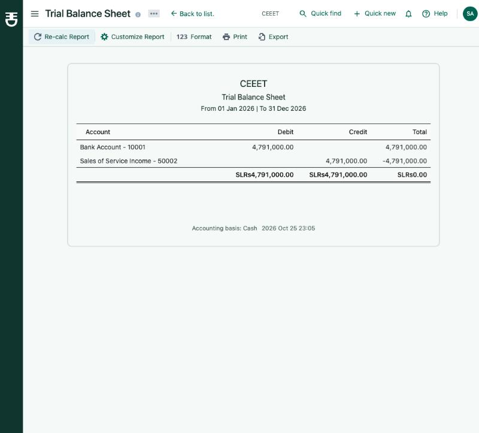
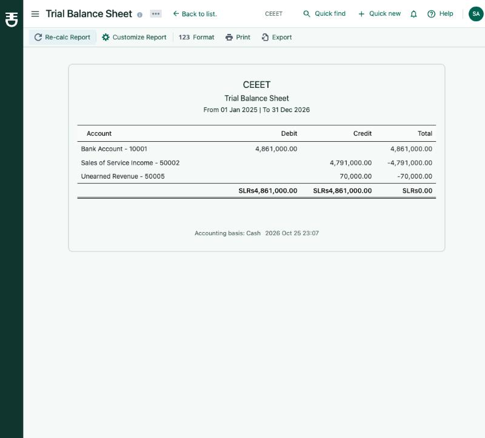

Accrual trial balance is unchanged:

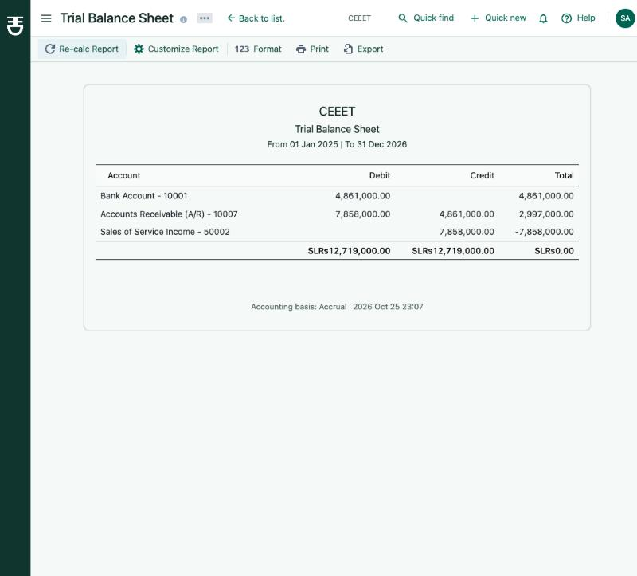

The first version also split a payment's excess between an unpaid opening balance (Other Income) and Unearned
Revenue by a hidden "oldest first" rule. That rule is gone: the opening balance is now an explicit line of the
payment (section 9), and the excess goes only to Unearned Revenue / Prepaid Expenses.

## 2. Bill payment excess and over-applied check

From [api-demo-refunds-and-bill-payments.txt](api-demo-refunds-and-bill-payments.txt) (disposable test org):

```
pay 500 but apply 1000 -> HTTP 400: {"type": "PAYMENT_ENTRIES_EXCEED_AMOUNT"}
pay 1300, apply 1000  -> HTTP 201
cash    Bank Account  1000 Cr | Office expenses  1000 Dr
cash    Bank Account   300 Cr | Prepaid Expenses  300 Dr   <- new
accrual Bank Account  1300 Cr | Accounts Payable 1300 Dr
```

Note: the Payment Made form spreads the "Full amount" over the bills, so the UI itself never sends an over-applied
payment (tried in the browser: setting 400 against a 500 line saved as 400/400). The server check is a backstop for
API and import calls; the webapp toast handles the error if it ever comes back.

## 3. Zero-total or missing document

Covered by unit specs (`keeps the bank line when the invoice total is zero`, `...when the invoice is missing`,
`keeps the payment account line...`, `keeps the withdrawal/deposit line...` for both refunds). The bank line is kept
and balanced by Unearned Revenue (customer side) or Prepaid Expenses (vendor side). Not reproducible through the UI,
because validation won't let you apply money to a zero-total document.

## 4. Registers show each payment once

Before — PAY-0028 four times, every other payment twice:

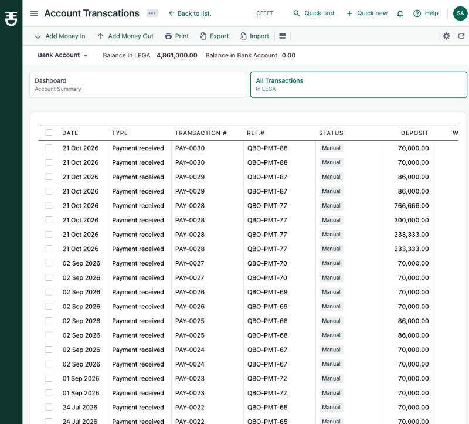

After — one row per payment; PAY-0002 once at 290,000:

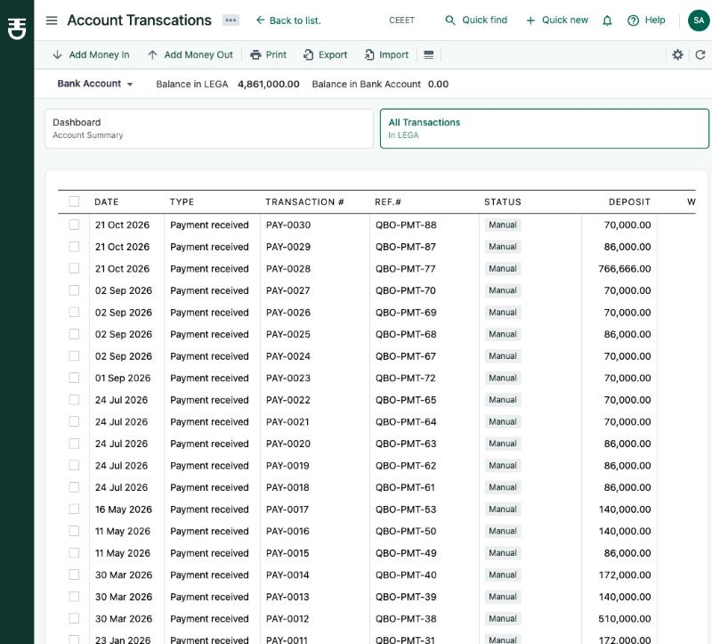
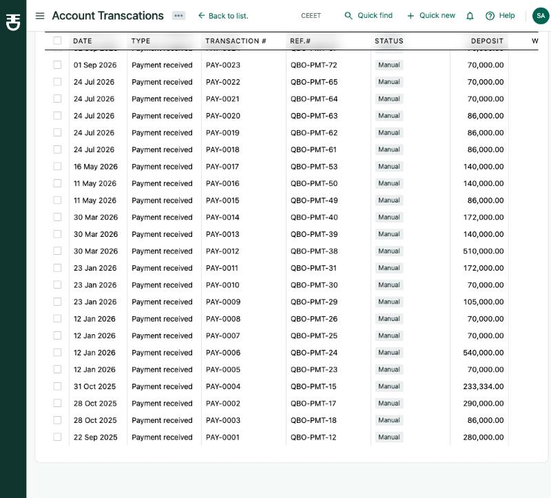

Account drawer (Chart of Accounts → Bank Account) after:

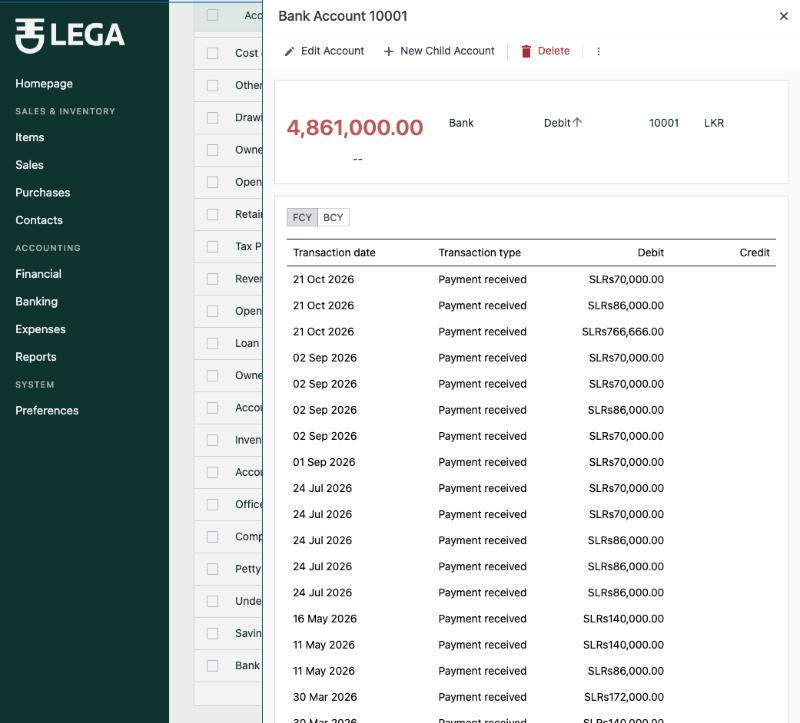

## 5. Editing a paid bill rewrites its payment's cash entries

Done in the browser with test records (vendor/item/bill/payment named "CASH-BASIS TEST"): bill 1,000, paid 500 from
Petty Cash, then a 100 discount added to the bill.

Cash journal before the edit (Office expenses 500):

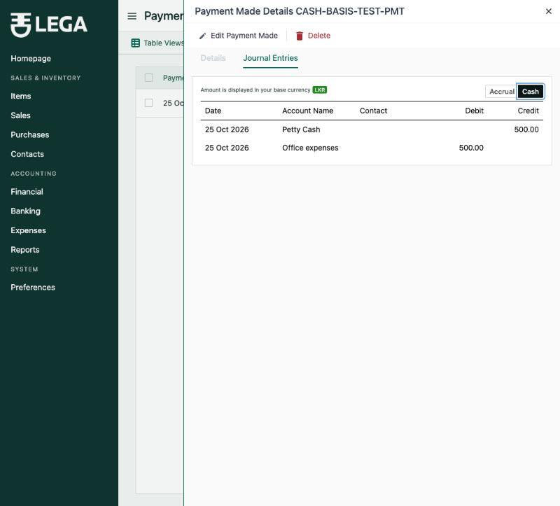

Bill edit:

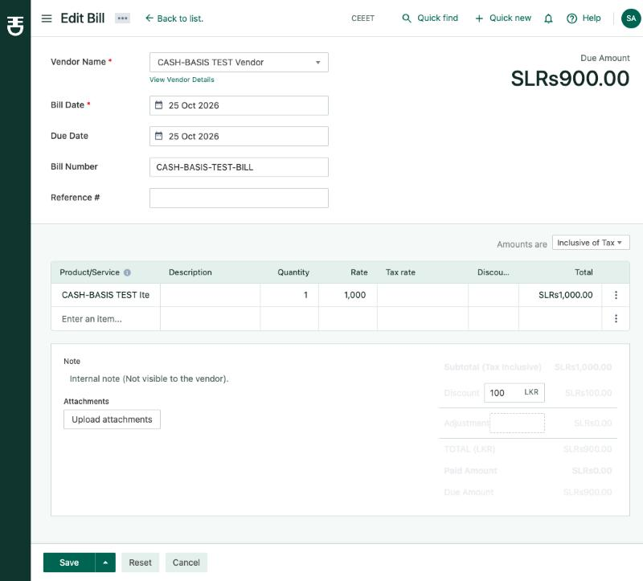

Cash journal after the edit (Office expenses 555.56, Purchase Discount 55.56, Petty Cash 500):

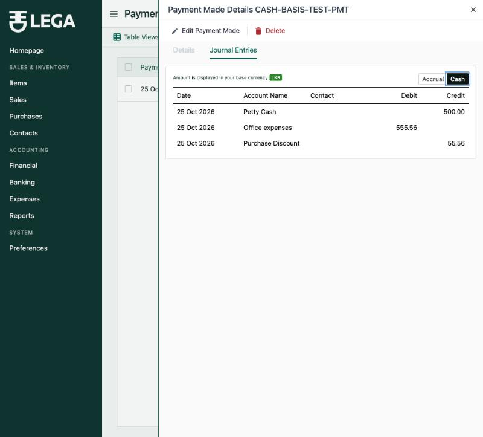

DB: [db-bill-payment-after-edit.txt](db-bill-payment-after-edit.txt). The invoice equivalent is covered by e2e.

## 6. Editing a credit note / vendor credit after a refund

From [api-demo-refunds-and-bill-payments.txt](api-demo-refunds-and-bill-payments.txt): refund 500 of a 1,000 credit
note, then the credit note is edited to 800 Sales of Service + 200 Other Income:

```
before: cash Sales of Service Income 500 Dr
after:  cash Sales of Service Income 400 Dr, Other Income 100 Dr   (accrual set untouched)
```

Same for a vendor credit (COGS 500 Cr → COGS 400 Cr + Office expenses 100 Cr).

## 7. Rounding

Every pro-rata set is rounded to 3 decimals with the remainder on the last line (unit specs: 100 split three ways →
33.333 / 33.333 / 33.334 for payments, bill payments, both refunds and cost lines). `--check` reports all entry sets
balanced on both tenants checked.

## 8. Untagged legacy entries

No local tenant still has untagged document entries (all were created after the column existed), so this was
simulated on the disposable test org ([migration-demo-untagged.txt](migration-demo-untagged.txt)):

```
correctly tagged:            cash-basis income 11,505
after untagging invoices:    cash-basis income 660,944   (unpaid invoice income counted on cash basis)
after the backfill migration: cash-basis income 11,505
rebuild + check:             no differences
```

## 9. Opening balance as an open item (replaces the hidden split)

**What the user sees.** A customer's (or vendor's) unpaid opening balance is a row in the Payment Received (Payment
Made) form, before the invoices (bills): *"Opening balance · 2026 Feb 01 · Amount due 300"*. The amount auto-fill
fills it first (it is the oldest item); the user can change it, e.g. to 0. Once fully paid the row no longer shows.
Deleting or editing a payment reopens only what that payment paid — no other payment changes. The customer/vendor
drawer shows *"Opening balance due 0.00 (paid 300.00)"*. The payment drawer shows *Applied* and *Unapplied
(credit)*.

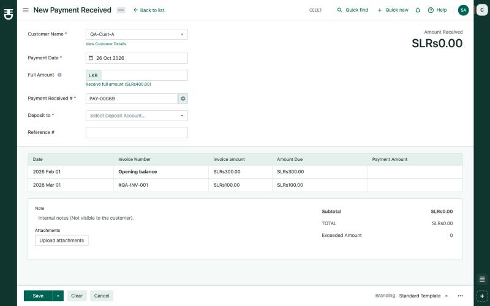
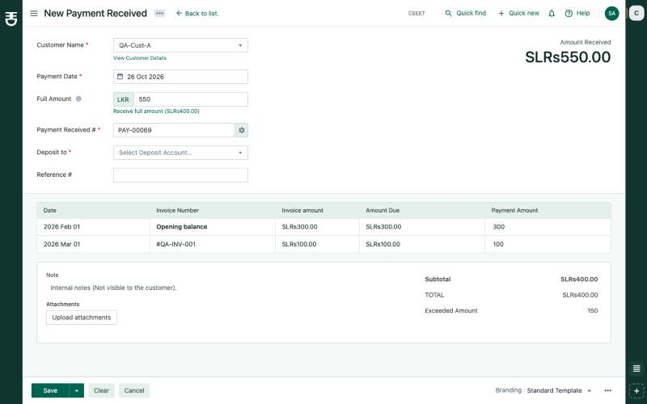
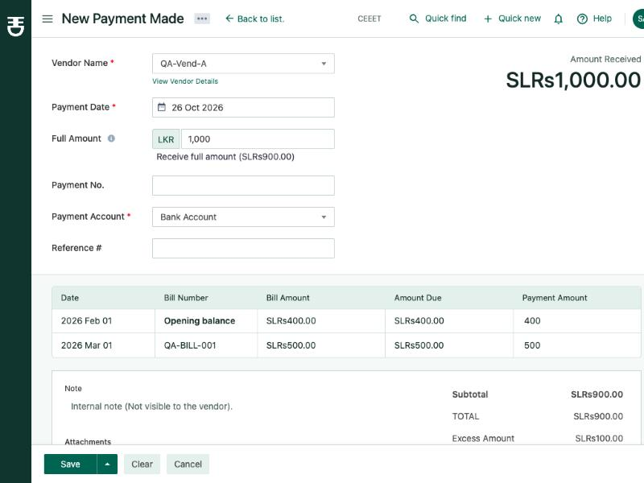

**Books.** Plan example (opening balance 300, invoice 100, payment 550), PAY-00069 in CEEET:

```
cash    Bank Account   300 Dr | Other Income             300 Cr   <- opening balance line
cash    Bank Account   100 Dr | Sales of Service Income  100 Cr   <- invoice line
cash    Bank Account   150 Dr | Unearned Revenue         150 Cr   <- only the true excess
accrual Bank Account   550 Dr | Accounts Receivable      550 Cr   (unchanged)
```

Vendor (opening balance 400, bill 500, payment 1,000): Bank 1,000 Cr = Other Expenses 400 + bill expense 500 +
Prepaid Expenses 100; accrual A/P 1,000 Dr / Bank 1,000 Cr. Accounts are as before: Other Income / Other Expenses for
opening balances (looked up from the opening-balance ledger entry, falling back to the default account), Unearned
Revenue / Prepaid Expenses for advances.

**How it works.**
- Migration `20261025120100_add_opening_balance_payment_entries` (replaces `..._add_contact_payment_date_index`,
  which was rolled back first on the two tenants that had it): `entry_type` (`invoice` | `opening_balance`, default
  `invoice`) on `payment_receives_entries` and `bills_payments_entries`; `contacts.opening_balance_payment_amount`
  (the paid part, like an invoice's `payment_amount`).
- Payment DTOs take `entryType`; `invoiceId` / `billId` are required only for invoice lines.
- Validation: invoice/bill checks skip opening-balance lines; a customer payment needs an invoice **or** the
  opening-balance line; at most one opening-balance line (`OPENING_BALANCE_ENTRY_DUPLICATE`); the contact must have an
  opening balance (`OPENING_BALANCE_NOT_FOUND`); the amount must be 0..due, where due adds back the edited payment's
  own amount (`OPENING_BALANCE_PAYMENT_EXCEEDS_DUE`). The contact row is locked (`FOR UPDATE`) inside the save, so
  two payments saved at the same moment can't both pay the whole opening balance (tested with 3 parallel calls).
- `ContactOpeningBalancePayment.syncPaidAmount` keeps `opening_balance_payment_amount` in step on create/edit/delete
  (difference only; a changed contact would move the amount, although changing a payment's contact stays blocked by
  the existing rule).
- Editing the opening balance: rejected below the paid amount (`OPENING_BALANCE_BELOW_PAID`, "Payments already paid
  200 of the opening balance; it can't be set to 150."); the save now runs in the transaction with the contact row
  locked; payments with an opening-balance line get their cash lines rewritten.
- `GET /payments-received/new-page/entries?customerId=` (new) and `GET /bill-payments/new-page/entries?vendorId=`
  return the opening-balance row first; the edit pages include it with the payment's own amount.
- Removed: `ContactOpeningBalanceCashAllocation.service.ts` (the account lookup moved to
  `ContactOpeningBalanceAccount.service.ts`), both `*OpeningBalanceCashSubscriber.ts`, their specs and wiring.
- `tenants:rebuild-cash-basis --check` now also reports contacts whose stored paid amount differs from their payment
  lines (an error), and lists, for review only, contacts with an opening balance due **and** unapplied payment
  credit, so an accountant can edit those payments and fill the opening-balance line. Nothing is changed
  automatically.

**Existing data.** Payments saved under the hidden rule keep their old cash lines until the next rebuild; the rebuild
re-posts their excess to Unearned Revenue (the opening balance stays due). In CEEET the check lists *Test Nimal*
(opening balance due 300, unapplied 200 on PAY-00065). *OB Demo Kamal* is no longer listed: PAY-00067 now has an
opening-balance line of 300, so Kamal's opening balance is fully paid (300 of 300) and the payment has no unapplied
credit.

## 10. Usability fixes for the other changes

| | Before | After |
|---|---|---|
| B1 | Customer payment with no invoice: "Save as credit?" → dialog closed, nothing saved, no message | Red message *"Select at least one invoice to apply this payment to."* before any dialog; server errors (`INVOICES_IDS_NOT_FOUND`, `INVOICES_NOT_DELIVERED_YET`, the opening-balance errors) have messages; the excess dialog closes only after a successful save |
| B2 | Payment drawer showed only the amount | Header and footer show *Applied* and *Unapplied (credit)* (`appliedAmount` / `unappliedAmount` on both payment transformers); the opening-balance line is labelled |
| B3 | Payment Made with lines above the amount showed "Excess" (Math.abs) and asked to save it as credit | Message *"The amount applied to bills (1,000.00) is more than the payment amount (500.00)…"* before saving; only a real excess opens the dialog. Both payment forms compare amounts in whole cents (like the server), so 1.10 + 2.20 against 3.30 saves instead of being refused by float error; 3.29 is still blocked |
| B4 | Editing a document rewrote linked payments/refunds even in a locked period | The invoice, bill, credit-note and vendor-credit *editing* events check the linked payments/refunds with `TransactionsLockingGuard`; a locked one blocks the edit before anything is saved: *"QA-PMT-MAR (28 Mar 2026) is linked to this bill and is in a locked period (locked up to 31 Mar 2026). Editing would change that period: unlock it first, or leave this bill unchanged."* |
| B5 | Accrual-only screens looked wrong next to cash reports | "(accrual)" + tooltip on the Chart of Accounts Balance column; "Accrual basis" in the account drawer and the bank register bar; Unearned Revenue / Prepaid Expenses drawers link to the General Ledger on the cash basis. This needed a fix to the General Ledger account filter: query-string ids arrived as strings and never matched the numeric account ids, so any account-filtered ledger was empty (`GeneralLedgerQuery.dto.ts`) |

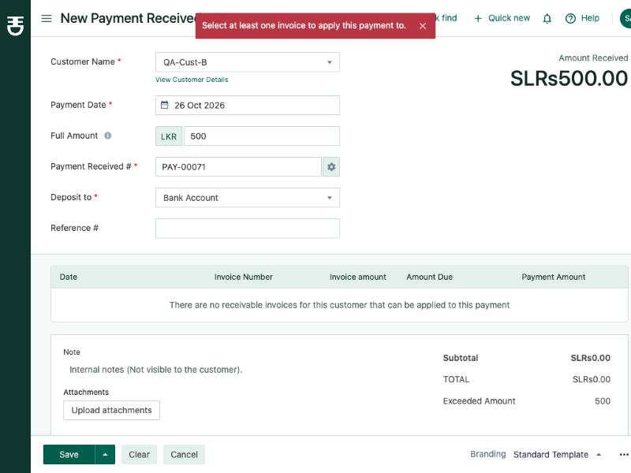
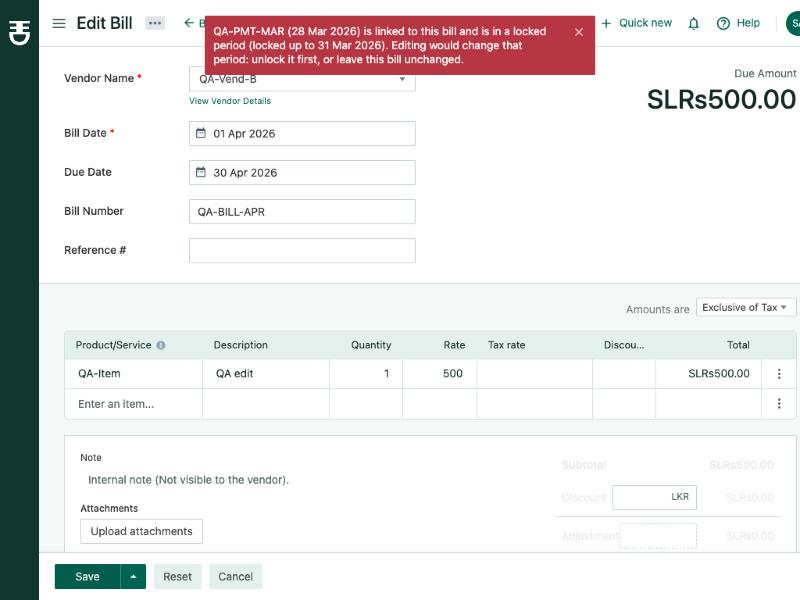
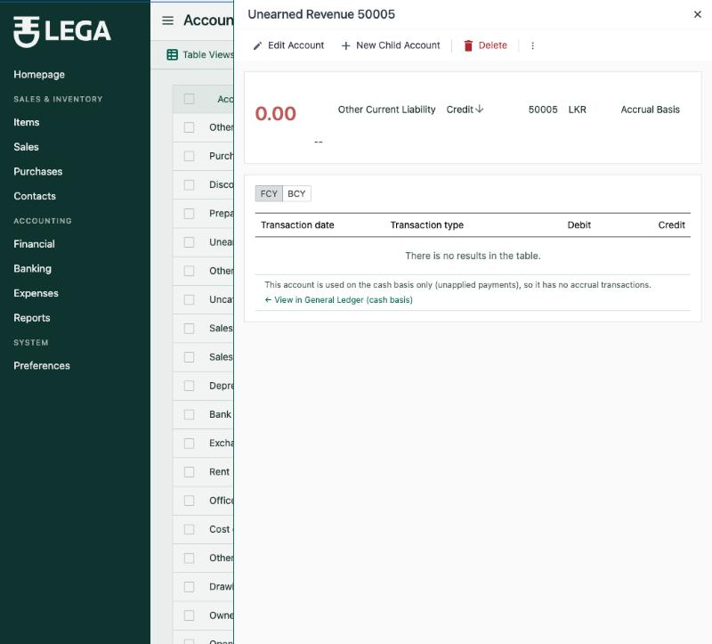
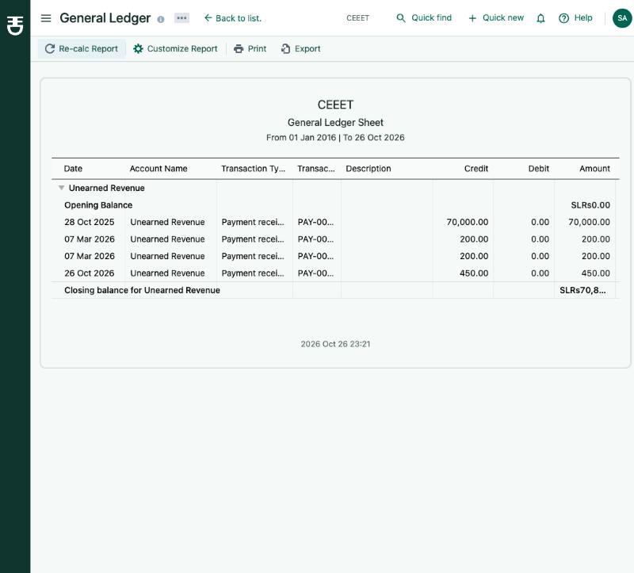

## Data repair run on CEEET

```
$ node dist/cli.js tenants:migrate:latest -t 96rherk78imvmvdogt     -> 2 migrations
$ ... tenants:rebuild-cash-basis -o 96rherk78imvmvdogt --check       (before rebuild)
  #1000 Bank Account: cash 4791000, accrual 4861000 (diff -70000)
$ ... tenants:rebuild-cash-basis -o 96rherk78imvmvdogt
  Rebuilt: PaymentReceive 30 ... Bank/cash accounts match. Entry sets: all balanced.
$ ... tenants:rebuild-cash-basis -o 96rherk78imvmvdogt --check       -> no differences
```

A second rebuild produced an identical hash of all cash-basis rows (93 rows), so it is idempotent.
Files: [cli-check-before.txt](cli-check-before.txt), [cli-rebuild.txt](cli-rebuild.txt), [cli-check-after.txt](cli-check-after.txt).

## Tests

| Suite | Result |
|---|---|
| Server unit (whole suite, `jest`), 2026-10-26 | 90 suites, 466 tests passed (old allocation/subscriber specs removed; new specs for the opening-balance validation + sync, opening-balance cash lines, the linked-transactions lock guard and the editing-event checks) |
| `test/gl-accounting-basis.e2e-spec.ts` | 34 passed (opening balance as an open item ×8, vendor opening balance, locked linked payment) |
| All other e2e suites | 60 of 61 pass; `attachments` fails on its presigned-URL test (404 from file storage, unrelated). A single in-band run runs out of memory after ~23 suites, so suites were run in batches |
| Server `tsc --noEmit` | clean |
| Webapp `tsc --noEmit` | clean |
| ESLint / Prettier on changed server and webapp files | clean (only warnings that were already there) |
| Browser (CEEET, `QA-` contacts) | see section 9/10 and the session report: C1–C19, V1–V21, L1–L3, P1 |

---

## Changed files by change area, with proposed commit messages

Paths are under `packages/server/src/` unless noted. A few files carry two areas (noted); commit them with the
first area that uses them, or split with `git add -p`.

**1. Rounding helper** — `feat(server): add ledger rounding helper for pro-rata GL lines`
- `utils/ledger-rounding.ts`, `utils/ledger-rounding.spec.ts` (new)

**2. Customer payment cash entries** — `fix(server): post unapplied customer payment amounts on the cash basis`
- `modules/PaymentReceived/commands/PaymentReceivedCashGL.ts` (+ `.spec.ts`)
- `modules/PaymentReceived/commands/PaymentReceivedCostCashGL.ts` (+ `.spec.ts`)
- `modules/PaymentReceived/commands/PaymentReceivedGLEntries.ts` (also uses area 4)
- `modules/Ledger/LedgerStorage.service.ts` (optional `{ basis }` on `deleteByReference`)

**3. Bill payment cash entries + validation** — `fix: post unapplied bill payment amounts on the cash basis and reject over-applied payments`
- `modules/BillPayments/commands/BillPaymentCashGL.ts` (+ `.spec.ts`)
- `modules/BillPayments/commands/BillPaymentGLEntries.ts` (also uses area 4)
- `modules/BillPayments/commands/BillPaymentValidators.service.ts`, `BillPaymentValidators.spec.ts` (new)
- `modules/BillPayments/commands/CreateBillPayment.service.ts`, `EditBillPayment.service.ts`, `modules/BillPayments/constants.ts`
- `packages/webapp/src/containers/Purchases/PaymentsMade/PaymentForm/utils.tsx`, `.../PaymentsMade/constants.ts`

**4. Opening balance as an open item** — `feat: pay contact opening balances as an explicit line in payments`
- `database/tenant/migrations/20261025120100_add_opening_balance_payment_entries.ts` (new)
- `modules/Contacts/ContactOpeningBalance.constants.ts`, `ContactOpeningBalanceAccount.service.ts`, `ContactOpeningBalancePayment.service.ts` (+ `.spec.ts`) (new), `Contacts.module.ts`, `models/Contact.ts`, `Contact.transformer.ts`
- `modules/Customers/models/Customer.ts`, `queries/CustomerTransformer.ts`, `commands/EditOpeningBalanceCustomer.service.ts`; `modules/Vendors/models/Vendor.ts`, `queries/VendorTransformer.ts`, `commands/EditOpeningBalanceVendor.service.ts`
- `modules/PaymentReceived/`: `dtos/PaymentReceived.dto.ts`, `models/PaymentReceivedEntry.ts`, `types/PaymentReceived.types.ts`, `commands/{CreatePaymentReceived.serivce,EditPaymentReceived.service,PaymentReceivedDTOTransformer,PaymentReceivedValidators.service,PaymentReceivedInvoiceSync.service,PaymentReceivedAccrualGL,PaymentReceivedCostGLEntries}.ts`, `queries/{PaymentsReceivedPages.service,PaymentReceivedEntryTransformer,GetPaymentReceivedMailState.transformer,GetPaymentReceivedMailTemplateAttrs.transformer}.ts`, `utils.ts`, `PaymentsReceived.controller.ts`, `PaymentReceived.application.ts`, `subscribers/PaymentReceivedOpeningBalanceSubscriber.ts` (new), `PaymentsReceived.module.ts`
- `modules/BillPayments/`: `dtos/BillPayment.dto.ts`, `models/BillPaymentEntry.ts`, `types/BillPayments.types.ts`, `commands/{CreateBillPayment.service,EditBillPayment.service,CommandBillPaymentDTOTransformer.service,BillPaymentValidators.service,BillPaymentBillSync.service,BillPaymentAccrualGL,BillPaymentsPages.service}.ts`, `queries/BillPaymentEntry.transformer.ts`, `subscribers/{BillPaymentBillSyncSubscriber,BillPaymentOpeningBalanceSubscriber (new)}.ts`, `BillPayments.module.ts`
- cash GL: `PaymentReceivedCashGL.ts`, `PaymentReceivedGLEntries.ts`, `BillPaymentCashGL.ts`, `BillPaymentGLEntries.ts` (+ specs; also areas 2/3)
- `modules/AccountingBasis/CashBasisCheck.ts` (paid-amount check + review list)
- webapp: `hooks/query/payment-receives/{queries,query-keys}.ts`, `hooks/query/payment-mades/queries.ts`, `containers/Sales/PaymentsReceived/PaymentReceiveForm/{PaymentReceiveInnerProvider,utils,components,PaymentReceiveForm.schema}.tsx`, `containers/Purchases/PaymentsMade/PaymentForm/{utils,components,PaymentMadeForm.schema}.tsx`, `containers/Drawers/{CustomerDetailsDrawer,VendorDetailsDrawer}/*{Header,Provider}.tsx`, `containers/Dialogs/{Customer,Vendor}OpeningBalanceDialog/*Form.tsx`

**4b. Usability fixes** — `fix(webapp): clearer payment messages, applied/unapplied amounts and accrual labels` and
`fix(server): block document edits that would change payments in a locked period`
- B1/B3: `PaymentReceiveForm.tsx`, `dialogs/ExcessPaymentDialog/ExcessPaymentDialogContent.tsx`, `PaymentMadeForm.tsx`, `dialogs/PaymentMadeExcessDialog/PaymentMadeExcessDialogContent.tsx`, the two form `utils.tsx`
- B2: `PaymentReceivedTransformer.ts`, `BillPaymentTransformer.ts`; webapp `Drawers/PaymentReceiveDetailDrawer/*`, `Drawers/PaymentMadeDetailDrawer/*`
- B4: `modules/TransactionsLocking/guards/LinkedTransactionsLockingGuard.ts` (+ `.spec.ts`) (new), `TransactionsLocking.module.ts`; `SaleInvoices/InvoicePaymentsGLRewrite.ts`, `SaleInvoices/subscribers/InvoicePaymentGLRewriteSubscriber.ts`, `BillPayments/commands/BillPaymentsGLRewrite.ts`, `BillPayments/subscribers/BillPaymentGLRewriteSubscriber.ts`, `CreditNotes/subscribers/RefundCreditNoteGLEntriesSubscriber.ts`, `CreditNoteRefunds/commands/RefundCreditNoteGLEntries.ts`, `VendorCreditsRefund/{commands/RefundVendorCreditGLEntries,subscribers/RefundVendorCreditGLEntriesSubscriber}.ts` (+ specs), the four modules; webapp `hooks/useApiFetcherOnError.tsx`
- B5: webapp `containers/Accounts/utils.tsx`, `Drawers/AccountDrawer/{AccountDrawerHeader,AccountDrawerTable}.tsx`, `CashFlow/AccountTransactions/AccountTransactionsDetailsBar.tsx`; server `FinancialStatements/modules/GeneralLedger/GeneralLedgerQuery.dto.ts` (account filter ids as numbers)

**5. Refund cash entries** — `fix(server): round refund cash entries and keep the bank line on zero-total credits`
- `modules/CreditNoteRefunds/commands/RefundCreditNoteCashGL.ts` (+ `.spec.ts`)
- `modules/VendorCreditsRefund/commands/RefundVendorCreditCashGL.ts` (+ `.spec.ts`)
- `modules/CreditNoteRefunds/commands/RefundCreditNoteGLEntries.ts`, `modules/VendorCreditsRefund/commands/RefundVendorCreditGLEntries.ts` (also area 6)

**6. Rewrite on document edit** — `fix(server): rewrite payment and refund cash entries when the document is edited`
- `modules/BillPayments/commands/BillPaymentsGLRewrite.ts`, `modules/BillPayments/subscribers/BillPaymentGLRewriteSubscriber.ts` (+ `.spec.ts`) (new)
- deleted: `modules/Bills/commands/BillPaymentsGLEntriesRewrite.ts`, `BillPaymentsGLEntriesRewriteSubscriber.ts` (commented-out dead code)
- `modules/CreditNotes/subscribers/RefundCreditNoteGLEntriesSubscriber.ts` (+ `.spec.ts`)
- `modules/VendorCreditsRefund/subscribers/RefundVendorCreditGLEntriesSubscriber.ts` (+ `.spec.ts`)
- `modules/SaleInvoices/InvoicePaymentsGLRewrite.ts` (missing `trx`), `modules/SaleInvoices/subscribers/InvoicePaymentGLRewriteSubscriber.spec.ts` (new)

**7. Registers read accrual only** — `fix(server): show each transaction once in registers and contact reports`
- `modules/BankingTransactions/queries/GetBankAccountTransactions/GetBankAccountTransactionsRepo.service.ts` (list + opening balance)
- `modules/Accounts/GetAccountTransactions.service.ts`
- `modules/FinancialStatements/modules/{CustomerBalanceSummary,VendorBalanceSummary,TransactionsByCustomer,TransactionsByVendor}/*Repository.ts`
- `modules/PaymentReceived/queries/GetPaymentReceived.service.ts`, `modules/BillPayments/queries/GetBillPayment.service.ts`, `modules/BankingTransactions/queries/GetBankTransaction.service.ts`

**8. Data repair** — `feat(server): backfill document basis and add tenants:rebuild-cash-basis`
- `database/tenant/migrations/20261025120000_backfill_documents_basis.ts` (new)
- `modules/AccountingBasis/` (new: constants, `CashBasisCheck.ts`, `CashBasisRebuild.service.ts`, `CashBasisRebuild.processor.ts`, module)
- `modules/CLI/commands/TenantsRebuildCashBasis.command.ts` (new), `modules/CLI/CLI.module.ts`, `modules/App/App.module.ts`, `packages/server/package.json` (script)
- `modules/CreditNoteRefunds/CreditNoteRefunds.module.ts`, `modules/VendorCreditsRefund/VendorCreditsRefund.module.ts` (export the GL services)

**Tests / docs**
- `packages/server/test/gl-accounting-basis.e2e-spec.ts` — `test(server): e2e for cash-basis excess, edits and registers`
- `docs/cash-basis-ledger/` — `docs: cash-basis ledger verification report`

## Where the implementation differs from the plan, and why

- **Node version.** `nvm` isn't installed on this machine. I used the project toolchain at
  `~/.local/share/lega-v2-toolchain` (Node 18.20.8 + pnpm), not 18.16.1.
- **Rebuild runs inside the server.** The CLI module doesn't load the ledger services (request-scoped, need tenant
  context), so `tenants:rebuild-cash-basis` queues a BullMQ job (`cash-basis-rebuild`) that the running server
  processes, then waits for it and prints the result. **The server must be running for a rebuild**; `--check` is plain
  SQL and runs from the CLI alone. Options: `-o <org>`, `--check`, `--timeout <minutes>`. Exit code 1 when anything differs.
- **Rebuild also removes orphan cash sets** (cash entries whose payment/refund no longer exists).
- **Opening-balance account** is read from the opening-balance ledger entry (fallback: Other Income / Other Expenses
  by slug, which is what the opening balance uses anyway).
- **Zero-total refunds** need a balancing line: Unearned Revenue (credit-note refund) or Prepaid Expenses
  (vendor-credit refund), mirroring the payment side.
- **Document-edit rewrites of payments are full rewrites** (as the existing invoice one is), because the accrual
  exchange gain/loss also depends on the document. Refund rewrites and opening-balance recomputes are cash-only.
- **Changing a payment's customer/vendor on edit** stays blocked (existing rule: the field is disabled and the server
  returns `PAYMENT_CUSTOMER_SHOULD_NOT_UPDATE`). The paid-amount sync would handle it if the rule is lifted.
- **Opening-balance lines with foreign currency**: the exchange difference of an opening-balance line is taken as zero
  (it uses the payment's rate), consistent with "foreign-currency cash entries out of scope".
- The excess lines carry the `contactId` (customer/vendor) for traceability; cash entries never change stored balances.

## Follow-ups (not done here)

1. **`SaleInvoice.total` ignores tax and adjustment** — `defaultTo(0, this.taxAmountWithheld)` / `defaultTo(0, this.adjustment)`
   (arguments reversed, from upstream commit 176e461b5). For tax-exclusive or adjusted invoices the A/R line, due
   amount and cash ratio are wrong, and those sets won't balance (`--check` will list them). `Bill.total` is correct.
   CEEET is unaffected (no taxes, adjustments or discounts).
2. Out of scope per the plan: foreign-currency cash entries, landed cost on cash basis, vendor-credit tax lines,
   upstream reporting.
3. Migration + rebuild were run only on CEEET and the test org. Other local tenants need
   `tenants:migrate:latest` then `tenants:rebuild-cash-basis` (none of them has untagged entries today).
4. Seen in passing: the Payment Made drawer showed "Due amount 0" and the bill edit form "Paid Amount 0" for a
   partly paid bill; the server log has ClickHouse `accounts_dim does not exist` errors. Both pre-existing.
5. Seen while testing the opening-balance work (original app, not changed here):
   - Deleting a customer that has payments fails with a database error (HTTP 500 "something went wrong") instead of a
     "has transactions" message; vendors get a clean `VENDOR_HAS_TRANSACTIONS`.
   - The Edit Opening Balance dialog shows today's date instead of the stored opening-balance date, so saving it
     moves the date.
   - Editing a paid bill can bring its total below the amount already paid (a 50 discount on a fully paid 500 bill
     was accepted).
   - The vendor create API only accepts whole-number opening balances (`isInt`); the opening-balance endpoint takes
     decimals.
   - Auto-fill in both payment forms drops decimals (`toSafeInteger`), e.g. 100.555 fills 100 (the plan's follow-up).
   - The Payment Received footer shows "Exceeded Amount" and "Applied over amount received" with no decimals
     (`FormatNumber` without a currency), so 0.20 shows as 0. The checks themselves use the exact amount.
   - Customers can't be paid fully in advance (no invoice and no opening balance) while vendors can (plan follow-up).

## Environment notes / leftovers

- Your server on :3001 was stopped during verification, the branch build ran there, and your original server
  (`packages/server/dist/main` from the main checkout, Node 24) was restarted afterwards. The vite dev server on :4000
  was not touched, so the webapp toast change wasn't loaded in the browser.
- CEEET now has the two new migrations applied and rebuilt cash sets. Your restarted server runs the old code, so its
  bank register shows duplicates again until this branch is deployed.
- **Test records left in CEEET** (not deleted, pending your OK): vendor "CASH-BASIS TEST Vendor" (id 46), item
  "CASH-BASIS TEST Item" (id 1052), bill CASH-BASIS-TEST-BILL (id 1), payment CASH-BASIS-TEST-PMT (id 1, Petty Cash 400).
- A local e2e test account `kk@kk.com` (credentials from `test/init-app-test.ts`) with org `96rherk2nfmvo4aet1` was
  created so the e2e suites can run; it holds e2e and demo data.
- 2026-10-26: the old `..._add_contact_payment_date_index` migration was rolled back (`knex.migrate.down` for that
  one file) on CEEET and the e2e org, then `tenants:migrate:latest` ran for **all** local tenants, so the other tenants
  also got the earlier backfill migration (a no-op where nothing is untagged) and the new opening-balance migration.
- The API server on :3001 now runs this branch's build (`/Users/Sanu/.local/bin/node`, Node 24, as before). Builds
  used the project toolchain (Node 18.20.8; `nvm`/18.16.1 is not installed).
- CEEET was rebuilt with `tenants:rebuild-cash-basis` (twice, identical) after the browser tests.
- All `QA-` test data (8 contacts, QA-Item, their invoices, bills, payments, credit note, vendor credit and refunds)
  was deleted through the app's API; no QA ledger rows remain and `--check` is clean. The transactions lock used for
  the locked-period tests was cancelled (the settings now hold a disabled lock with reason "QA test lock"; there was
  no lock before).
- Your earlier test customers Test Nimal (47), OB Demo Kamal (48), Test Sanu (49) and the vendor test records above
  were not deleted; their old hidden-rule cash lines (PAY-00065 / PAY-00067: Other Income 200) were re-posted to
  Unearned Revenue by the rebuild, and `--check` lists 47 and 48 for review.
